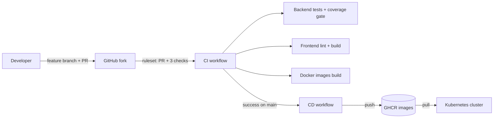
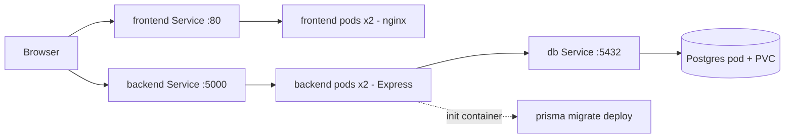

# DeskFlow Architecture

DeskFlow is an internal IT service request portal: React frontend, Node/Express API, PostgreSQL via Prisma, JWT-based role access.

## Delivery pipeline

## Runtime (Kubernetes)

## Components

| Component | Image | Notes |
|---|---|---|
| frontend | `ghcr.io/lerumo-consulting/deskflow-frontend` | Vite build served by nginx, non-root-friendly, SPA fallback |
| backend | `ghcr.io/lerumo-consulting/deskflow-backend` | Multi-stage build, runs as `node`, HEALTHCHECK on `/api/health` |
| db | `postgres:16-alpine` | Data on a PersistentVolumeClaim |

## Health and resilience

- Backend readiness and liveness probes call `/api/health`; frontend probes call `/`.
- Readiness keeps traffic away from pods that are not ready; liveness restarts hung pods.
- Backend runs 2 replicas, so one pod can restart without downtime.
- Migrations run in an init container before the API starts.

## Quality gates

- Jest + Supertest suite (42 tests) with a coverage threshold enforced in CI.
- Branch protection ruleset on `main`: PR required, all three CI checks must pass.
- CD only runs after CI succeeds on `main`.
